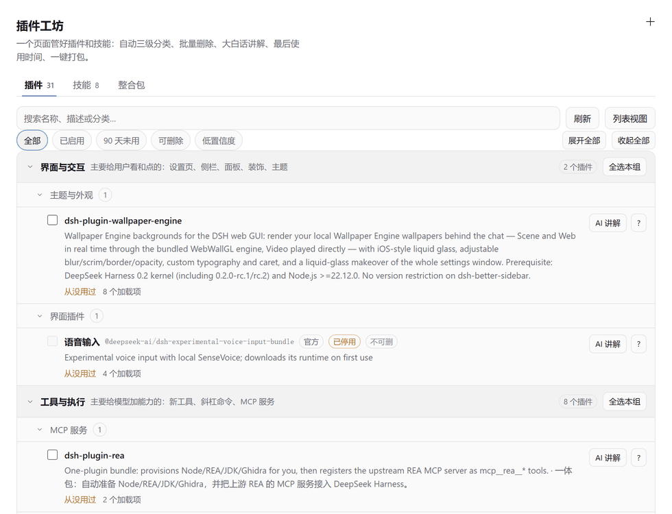
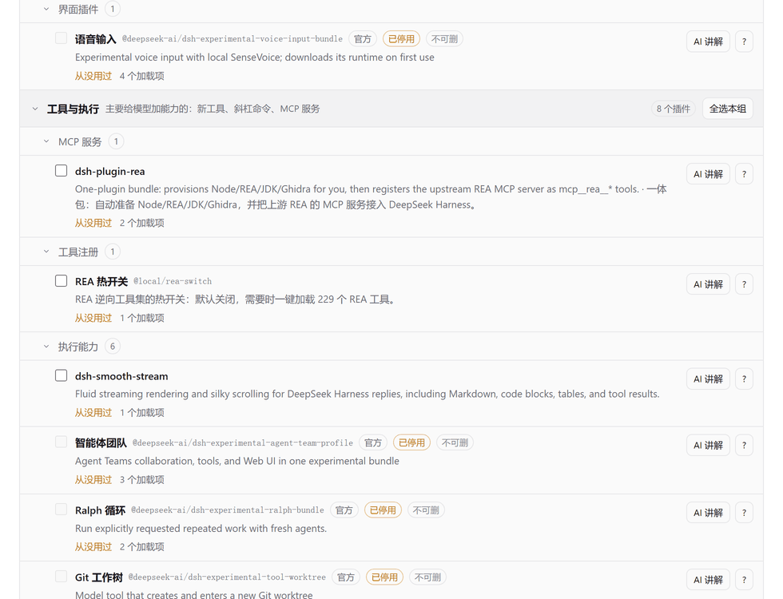

# 插件工坊 · dsh-plugin-studio

一个页面管好 DeepSeek Harness 的**插件**和**技能**：三级自动分类、批量删除、AI 大白话讲解、最后使用时间、一键打包。

它是 `dsh-modpack`（插件整合包）的下一代：原来的整合包只负责"打包带走"，工坊负责"平时怎么管"。



> 上面这张是真实运行截图，不是设计稿。31 个插件按三级树排列，每行前面有复选框，右侧是最后使用时间和操作按钮。

---

## 目录

- [为什么要有它](#为什么要有它)
- [六个功能](#六个功能)
- [安装](#安装)
- [界面说明](#界面说明)
- [使用场景](#使用场景)
- [常见问题](#常见问题)
- [开发](#开发)
- [跨版本兼容](#跨版本兼容)
- [HTTP 接口](#http-接口)
- [数据存放](#数据存放)
- [相关文档](#相关文档)

---

## 为什么要有它

装了十几个插件之后，Harness 的设置页会变成一长串平铺的列表。你想删掉几个不用的，但：

- **看不出哪个是干什么的** —— 名字是 `dsh-plugin-rea`，描述是一句英文，删了怕坏；
- **不敢删** —— 不知道删了会不会影响正在用的东西；
- **不知道哪个真的没用** —— "我好像三个月没碰它了"是感觉，不是证据；
- **插件和技能是两套地方** —— 管了插件还得另外管技能。

工坊把这四件事合到一个页面里：**分类 → 看懂 → 看使用记录 → 批量删**。

---

## 六个功能

### 1. 三级自动分类，不留"无法判断"

每个插件和技能都会被归到 **一级（大类）→ 二级（能力域）→ 三级（它自己）** 的三层树里。

一级分类共 8 个（`lib/classify.js` 的 `FAMILIES`）：

| 一级 | 管什么 | 举例 |
| --- | --- | --- |
| 界面与交互 `ui` | 给用户看和点的 | 壁纸、主题、侧栏、浮层 |
| 工具与执行 `tools` | 给模型加能力的 | 新工具、斜杠命令、MCP 服务 |
| 网络与数据 `net` | 联网或读写外部数据 | 抓取、同步、接口、账号 |
| 模型与推理 `model` | 接模型或改推理过程 | 模型接入、提示词、上下文压缩 |
| 会话与工作区 `session` | 管会话和文件 | 会话增删、工作区、终端 |
| 运维与诊断 `ops` | 管插件本身 | 插件管理、技能管理、诊断、备份 |
| 系统与内核 `core` | Harness 自带底座 | 通常不该删 |
| 其它与待确认 `other` | 证据不足但已归档 | 附原因，可人工改判 |

**关于"不再出现无法判断"**：`other` 这一级在分类法里保留着，但它是一个**有归属的归档**，不是"判断失败"——每一行无论证据多弱，都会拿到一个 family、一个 domain 和一条 `evidence` 说明理由，`confidence` 会诚实地标 `low`。实际在本机 28 行真实数据上，`other` 的命中数是 **0**。

分类不是"第一条规则命中就定案"，而是**加权评分**：

- **PURPOSE（10 分）**：作者自己写的标题和描述，只投一票，按"最窄的声明优先"排序；
- **CAPABILITY（3–10 分）**：代码里真正调用的服务。调 `pluginManager` 得 10 分、`llm` 8 分、`tools` 7 分、`sessionQuery` 6 分……这是最有辨识度的证据；
- **AMBIENT（1–2 分）**：几乎所有插件都有的东西。注册一个 UI 插槽、`dsh.client` 字段、`fetch`、`fs`——这些只用来打平手。

> **为什么不用"注册了 UI 插槽就是 UI 插件"？** 因为那回答的是"它画不画东西"，不是"它是干什么的"。优惠券插件、会话清理插件、插件管理器都画东西，但它们分属网络、会话、运维三个大类。早期版本正是踩了这个坑：9 个插件里 7 个被塞进"界面"，一级分类直接塌成一支，三级树失去意义。

同分时按 `TIE_ORDER = ['tools','net','model','session','ops','core','ui','other']` 裁决——**更具体的赢，`ui` 永远最后**。

### 2. 复选框批量删除 + 重启提示

每个插件/技能前面有复选框，可以单选也可以多选，选中后底部出现操作条。点删除会先弹确认框，列出**具体哪几个**会被删。

删除走的是 Harness 自己的 `pluginManager.removeBundle()`，不是手删文件。返回结果里的 `application` 字段决定要不要提示重启：

- `applied` → 已生效，不用重启；
- `restart-required` → 弹提示，并说明**为什么**要重启（`lib/remove.js` 的 `RESTART_TEXT` 把 `restartReason` 翻译成人话）：
  - `no-hmr` —— 这个包没有热重载，改完得重启才能换掉正在跑的代码
  - `package-moved` —— 包被移走了，进程还拿着旧路径
  - `host-module` —— 改的是宿主侧模块，只有重启才重新加载
  - `unmanaged-plugin` —— 这个插件不是包管理器装的，得重启
  - `module-comparison` —— 模块版本对不上，重启才能统一

有些行是**不可删**的（官方底座、只读、来源不明），它们会显示锁图标，复选框直接禁用，并在 `removable=false` 时给出原因。

删除是**串行**的：每删一个都会重写 profile 的依赖清单和 patch 文件，并发会丢改动。

### 3. AI 大白话分析

点每一行的「讲解」按钮，它会结合三样东西推理：

1. **代码实际做了什么** —— 读 `package.json` 的入口、`dsh.bundle.patch`、`dsh.client`，读源码里的 `slots.register(...)`、`tools.register(...)`、`llm.prepareCall` 等调用，提取注册了哪些插槽、提供了哪些工具名、碰了哪些子系统；
2. **作者自己怎么说的** —— 包的 `description`、README 开头、locale 里的 `meta.description`；
3. **GitHub 上能找到什么** —— 按包名搜 GitHub，校验仓库名或描述里真的出现了这个包名才算命中（防止同名项目误认），再取 README 开头作为佐证。结果缓存 7 天。

输出是三个字段，全部说人话：

- `what` —— **它帮你做什么**（"会在设置里加一个页面，让你给对话窗口换动态壁纸"）；
- `remove` —— **删了会怎样**（"删掉之后壁纸变回纯色，不影响聊天"）；
- `why` —— **依据是什么**（"代码里注册了 settings.section，并且调用了 theme.overrideTokens"）。

提示词里写死了一条规矩：**先说帮你做什么，再说删了会怎样**。不给术语，不说"该插件实现了 X 接口"。

### 4. 最后使用时间

这一列回答"我多久没碰它了"。数据来自 Harness 自己的会话日志（`sessionQuery.listSessions()` + `readSession()`，没有这个服务时回落到直接读 `~/.dsh/sessions/**/session.v4.jsonl.zstd`）。

**关键设计：区分"用过"和"提过"。**

- **真的用过**（`usedAt` / `usedVia`）：会话日志里出现过 `tool/call`，工具名匹配这个插件注册的工具。这才显示成"最后使用"。
- **只是被提到**（`mentionedAt`）：名字在对话里被说起过。这**不算使用**，单独用次要样式显示。

> **为什么较真？** 早期版本把"被提到"也算成使用，结果我们一边讨论插件、一边所有插件都被标成"刚刚使用"——28 行里 19 行都有时间，这一列直接失去意义。一条错误的信息比没有信息更糟。

日志读取有个坑：`session.v4.jsonl.zstd` 是**多帧 zstd 拼接**，`zstdDecompressSync(整个文件)` 只解第一帧。`lib/usage.js` 的 `decompressFrames()` 按 zstd magic `28 B5 2F FD` 扫描全部帧偏移，逐帧解压再拼接。

### 5. 技能管理页（和插件页功能对等）

第二个 tab 管技能，功能和插件页一致：三级分类、搜索筛选、复选框批量删除、一键打包。

技能从四个根目录扫描（`lib/skills.js` 的 `skillRoots()`）：

| 根目录 | scope |
| --- | --- |
| `<DSH_HOME>/skills` | `user-dsh` |
| `<DSH_HOME>/agents/skills` | `user-agents` |
| `<cwd>/.dsh/skills` | `project-dsh` |
| `<cwd>/.agents/skills` | `project-agents` |

优先用 `skills.list()` 服务拿清单，拿不到就自己扫目录（读 `SKILL.md` 的 frontmatter 取 `name` / `description` / `when_to_use`）。

删除技能有**两道守卫**：必须是目录、目录里必须有 `SKILL.md`——防止路径算错时删掉无关目录。

技能的二级分类比插件更细：`tools.skill.doc`（文档处理，office 系列）、`tools.skill.dev`（开发与诊断）、`tools.skill`（其它）。

### 6. 重命名 + 重新设计的界面

名字从「插件整合包」改成「插件工坊」，包名从 `dsh-modpack` 改成 `dsh-plugin-studio`，接口前缀改成 `/api/dsh-plugin-studio`。

界面设计上遵守了 Harness 客户端的三条硬规矩：

- **只用主题 token** —— 13 个 `--dsw-alias-*` / `--dsw-specific-*` 变量，零硬编码色值，深浅色自动跟随；
- **不碰别人的 DOM** —— 不 append 到 `document.body`、不查询别人的元素、不用 `innerHTML`；
- **样式可清理** —— 一个 `<style>` 标签，用 `ctx.effect()` 注册，卸载时自动移除。

三个 tab：**插件 / 技能 / 整合包**。视图可以在「三级树」和「平铺列表」之间切换，树可以逐级折叠，每个分组都有「全选本组」。

---

## 安装

### 方式一：从 GitHub 安装（推荐）

```
plugin_manager action: install_bundle
                target: github:KERBALMans/dsh-plugin-studio
```

装特定版本：

```
plugin_manager action: install_bundle
                target: github:KERBALMans/dsh-plugin-studio#v1.0.1
```

### 方式二：从 tgz 安装（离线/内网）

从 [Releases](https://github.com/KERBALMans/dsh-plugin-studio/releases) 下载 `dsh-plugin-studio-1.0.1.tgz`，然后：

```
plugin_manager action: install_bundle
                target: E:\下载路径\dsh-plugin-studio-1.0.1.tgz
```

### 方式三：从本地目录安装（改代码时用）

```
plugin_manager action: install_bundle
                target: E:\你的路径\dsh-plugin-studio
```

安装后 profile 里会出现一个指向源目录的 Junction，改源码即刻同步到 profile 磁盘。

### 安装完成后

打开 **设置 → 插件工坊**（在侧栏设置里，位于「插件」下面、「智能体预设」上面）。

> **装完看不到？** 如果页面没出现，重启一次客户端。运行中的 Host 会缓存已加载的 ES 模块，`plugin_manager` 报告 `application: "applied"` 只说明依赖装好了，不说明新代码已经在跑。

> **改完代码不生效？** 不用重启，禁用再启用一次即可：
> ```
> plugin_manager action: set_plugin target: "include:dsh-plugin-studio" enabled: false
> plugin_manager action: set_plugin target: "include:dsh-plugin-studio" enabled: true
> ```

---

## 界面说明



### 顶部：三个 tab

| tab | 管什么 |
| --- | --- |
| **插件** | 已安装的插件包（bundle） |
| **技能** | 技能工具（skill），功能与插件页对等 |
| **整合包** | 已保存的整合包，可一键装回 |

每个 tab 右边有计数，比如「插件 31」。右上角是**刷新**按钮。

### 工具栏

从左到右：

- **搜索框** —— 按名字、包名、描述搜，实时过滤；
- **筛选 chips** —— `全部` / `已启用` / `90 天未用` / `可删除` / `低置信度`，可以同时选多个（是"与"关系）；
- **视图切换** —— `三级树` ↔ `列表视图`；
- **展开全部 / 收起全部** —— 只在树视图下出现。

### 三级树

```
界面与交互                        2 个插件   [全选本组]
├─ 主题与外观                     1
│  └─ ☐ dsh-plugin-wallpaper-engine
│        Wallpaper Engine backgrounds for the DSH web GUI...
│        最后使用：3 天前           [讲解] [展开]
└─ 界面插件                       1
   └─ ☐ ...
```

- **一级**（粗体）：8 个大类之一；
- **二级**：能力域，每个大类下 1–5 个；
- **三级**：插件本身。

每一级都能点击折叠。二级标题右边有「全选本组」，勾上就选中这一组的所有插件。

### 每一行长什么样

```
☐ dsh-plugin-rea                      官方  已启用  高置信度
   MCP server for reverse engineering tools...
   最后使用：2 小时前（工具调用）
   ▸ 依据：代码里注册了 tools.register，并且调用了 ...
   [讲解] [展开]
```

- **复选框** —— 最左边，点它选中；
- **名称 + 徽章** —— `官方`（Harness 自带）、`已启用`/`已停用`、`高置信度`/`中置信度`/`低置信度`、`只读`（不可删）；
- **描述** —— 作者写的一句话；
- **最后使用** —— 见下方说明；
- **依据** —— 折叠的判定理由，展开能看到具体证据；
- **讲解** —— 点它调 AI 生成大白话说明；
- **展开** —— 显示完整描述、包名、版本、来源、注册了哪些插槽/工具。

### 关于「最后使用」这一列

有两种显示，**含义不同**：

| 显示 | 含义 |
| --- | --- |
| `最后使用：2 小时前（工具调用）` | **真的用过** —— 会话日志里有工具调用命中它注册的工具 |
| `最后使用：—` + 灰字 `5 天前提到过` | **只是被提到** —— 名字在对话里出现过，但没有实际调用 |

**为什么要区分？** 因为"提到"不等于"使用"。你在对话里说"这个插件不错"，不代表它工作了。如果混在一起，讨论插件的时候所有插件都会显示"刚刚使用"，这一列就失去意义了。

### 底部操作栏

勾选任意插件后，底部浮出操作栏：

```
已选 3 个    [打包]  [删除]  [取消选择]
```

- **打包** —— 把这 3 个打包成整合包，可以保存或分享；
- **删除** —— 弹确认框，列出具体哪几个会被删，确认后执行。

### 删除确认框

```
删除 3 个插件？

dsh-plugin-wallpaper-engine
dsh-aliyun-coupon
dsh-session-clean

这个操作会从 profile 里移除它们，并重写依赖清单。
[取消]  [确认删除]
```

删除后，如果某个包需要重启才能完全卸载，会再弹一个提示说明原因：

- 「这个包没有热重载，改完得重启才能换掉正在跑的代码」
- 「改的是宿主侧模块，只有重启才重新加载」

### 整合包 tab

显示已保存的整合包列表，每个显示名称、条目数、创建时间。可以删除。

---

## 使用场景

### 场景一：清理长期不用的插件

1. 打开插件工坊
2. 点筛选 chip **`90 天未用`**
3. 列表只剩很久没碰过的插件
4. 逐个看描述和最后使用时间，勾选要删的
5. 点删除，确认

### 场景二：搞不清某个插件是干什么的

1. 找到那个插件
2. 点 **`讲解`**
3. 等几秒，AI 会给出三段说明：
   - **它帮你做什么** —— "会在设置里加一个页面，让你给对话窗口换动态壁纸"
   - **删了会怎样** —— "删掉之后壁纸变回纯色，不影响聊天"
   - **依据是什么** —— "代码里注册了 settings.section，并且调用了 theme.overrideTokens"

### 场景三：换电脑，把插件配置带走

1. 在插件页勾选想带走的插件
2. 点 **`打包`**
3. 起个名字，保存
4. 把 `整合包` tab 里的文件拷到新电脑
5. 在新电脑上用 `plugin_manager` 应用，或者用 `studio_list` 工具

### 场景四：管理技能

技能页和插件页功能一样：三级分类、搜索、筛选、批量删除、打包。8 个内置技能会被分成「文档处理技能」（office 系列 7 个）和「开发与诊断技能」（1 个）。

---

## 常见问题

### 装完之后设置里没有「插件工坊」

1. 确认安装成功：`plugin_manager action: list_bundles`，找 `dsh-plugin-studio`
2. 如果列表里有，但页面没有，**重启客户端**
3. 如果列表里没有，重新安装

### 页面打开是空白的

页面顶部如果有红条提示「客户端与宿主版本不一致」，重启客户端即可。这是防止新旧代码混跑的保护。

### AI 讲解一直转圈或报错

AI 功能需要可用的模型。检查：

1. `设置 → 模型` 里有没有配置好的模型
2. 网络是否可达（GitHub 检索需要联网）

没有模型时，讲解按钮会显示"当前没有可用的模型"，不会卡住。

### 最后使用时间一直是空的

说明这个插件注册的工具从来没被调用过。这是**正常**的——很多插件是纯 UI 的，不注册工具，所以永远不会有"工具调用"记录。这种情况下会显示"未使用过"。

### 删除按钮是灰的

那一行不可删。原因可能是：

- 它是 Harness 官方底座（`removable: false`）
- 它是只读的
- 它的来源不明（不是通过包管理器装的）

鼠标悬停能看到具体原因。

### 删除后插件还在

1. 看删除时有没有弹重启提示。弹了就重启客户端
2. 重启后还在的话，检查 `plugin_manager action: list_bundles` 确认
3. 如果确实还在，可能是删除失败，重新删一次看错误信息

### 技能删除后还在

技能的启用/禁用是通过写 `.disabled` 标记文件实现的。删除会真的删目录，但需要重启才能让 Harness 重新扫描。

---

## 开发

### 目录

```
dsh-plugin-studio/
├── index.js              Host 半：apply()、HTTP 路由、Agent 工具
├── client.js             Client 半：设置页 UI
├── cordis.patch.yml      bundle 插入声明
├── package.json
├── icon.svg
├── locale/{zh,en}.json
├── lib/
│   ├── env.js            路径、请求体、JSON 响应、服务查找
│   ├── caps.js           能力探测（按方法存在性，不看版本号）
│   ├── inventory.js      插件清单（pluginManager 优先，文件回落）
│   ├── classify.js       三级分类：FAMILIES / DOMAINS / 加权评分
│   ├── usage.js          最后使用时间（会话日志扫描）
│   ├── skills.js         技能清单、删除、启停、打包
│   ├── ai.js             AI 讲解与 AI 分类
│   ├── remote.js         GitHub 检索与缓存
│   └── remove.js         删除与重启提示
└── scripts/              测试套件（见下）
```

### 测试

八个套件，全部不需要跑起 GUI：

```bash
node scripts/smoke.mjs     # 能力探测、清单回落、分类法自检
node scripts/analyse.mjs   # 真实数据跑完整管线
node scripts/routes.mjs    # 每个 HTTP 路由
node scripts/actions.mjs   # 打包、保存、删除、分类的读写
node scripts/ai.mjs        # AI 路由在无模型时的降级
node scripts/style.mjs     # 样式与模块契约审计
node scripts/render.mjs    # 用 React 替身渲染出真实 HTML
node scripts/compat.mjs    # 跨版本契约
```

调试用：

```bash
node scripts/scores.mjs                  # 打印每行的评分明细
node scripts/why.mjs <包名片段>          # 某一行为什么被分到那里
node scripts/measure.mjs                 # 用 headless Edge 量布局
```

### 改完代码怎么生效

不用重启客户端：

```
plugin_manager action: set_plugin target: "include:dsh-plugin-studio" enabled: false
plugin_manager action: set_plugin target: "include:dsh-plugin-studio" enabled: true
```

禁用再启用会强制 Host 重新加载模块。

---

## 跨版本兼容

`engines.dsh` 写的是 `>=0.2.0-rc.1`。真正让插件跨版本活下来的不是版本号，是**按方法存在性探测能力**：

```js
function has(target, name) {
  return !!target && typeof target[name] === 'function'
}
```

版本号告诉你发布者想给你什么，缺失的函数告诉你这个进程实际能做什么。

`scripts/compat.mjs` 为五个契约建模并逐个验证：

| 契约 | 模拟什么 | 结果 |
| --- | --- | --- |
| `0.2.1-rc.1` | 没有 `removeBundle`、没有 `inspect`、没有 `skills` 服务 | 降级运行，删除按钮禁用 |
| `0.2.1-rc.2` | 加上 `removeBundle` | 删除可用 |
| `0.2.1-rc.3` | 当前版本，全量服务 | 全部功能 |
| `future-additive` | 未来版本：只加不改，多出 `somethingBrandNew` 等未知方法 | 未知方法被忽略，行为不变 |
| `future-renamed` | 未来版本：**删掉 `listBundles`** | 回落到读 profile 文件，清单仍出得来 |

每个契约都断言同一组事：能力探测不抛、路由构建不抛、根路由返回 `apiVersion`、清单非空且每行有三级分类、无 `other`、分类有区分度、官方可选包没被判成内核、壁纸判成界面、会话清理判成会话、技能路由不崩、删除不存在的行被拒绝且不产生删除记录。

最后还有一段「空 ctx」：所有服务都拿不到时，`capabilityReport()` 要报出缺失项而不是抛异常，根路由仍要返回 200——这样 UI 能告诉用户"这个版本缺什么"，而不是白屏。

**已知限制**：本机只装了 `0.2.1-rc.3`，rc.1 / rc.2 无法真实安装验证，所以用的是契约级验证（模拟各版本的服务面）。这在工程上等价于"按接口编程"的验证，但不等价于"真的在 rc.1 上跑过"。

---

## HTTP 接口

所有接口在 `/api/dsh-plugin-studio` 下，先过 `connection.admit()` 鉴权。

| 方法 | 路径 | 作用 |
| --- | --- | --- |
| GET | `/` | 版本与接口清单 |
| GET | `/inventory` | 插件清单 + 三级树 + 使用时间 |
| GET | `/skills` | 技能清单 + 三级树 |
| GET | `/saved` | 已保存的整合包列表 |
| GET | `/diag` | 能力探测、模型、各根目录 |
| POST | `/pack` | 打包成整合包 |
| POST | `/save` | 保存整合包到磁盘 |
| POST | `/delete-pack` | 删除已保存的整合包 |
| POST | `/categories/save` | 手动改判分类 |
| POST | `/categories/reset` | 清空手动改判 |
| POST | `/suggest` | AI 批量分类 |
| POST | `/explain` | AI 大白话讲解 |
| POST | `/remove` | 删除插件 |
| POST | `/skills/remove` | 删除技能 |
| POST | `/skills/enable` | 启用/禁用技能 |
| POST | `/skills/pack` | 打包技能 |
| POST | `/plan` | 预览应用整合包会做什么 |
| POST | `/apply` | 应用整合包 |

### Agent 工具

给模型用的三个工具：

- `studio_list` —— 列出插件或技能（带三级分类）；
- `studio_explain` —— 讲解某个插件；
- `studio_remove` —— 删除插件（支持 `dryRun`）。

---

## 数据存放

```
<DSH_HOME>/storages/dsh-plugin-studio/
├── plugin.json          安装标记
├── categories.json      手动改判 + AI 讲解缓存
├── remote-cache.json    GitHub 检索缓存（7 天）
└── packs/               已保存的整合包
```

整合包格式：

```json
{
  "format": "dsh-plugin-studio-pack",
  "formatVersion": 1,
  "meta": { "name": "...", "description": "...", "createdAt": 0, "kind": "plugin", "count": 0 },
  "entries": [
    {
      "key": "bundle:xxx",
      "kind": "bundle",
      "name": "xxx",
      "version": "1.0.0",
      "spec": "xxx@1.0.0",
      "category": { "family": "ui", "domain": "ui.theme", "familyLabel": "界面与交互", "domainLabel": "主题与外观" },
      "enabled": true,
      "official": false,
      "description": "..."
    }
  ]
}
```

---

## 许可

MIT

---

## 相关文档

- **[手动上传到 GitHub 网页版 · 小白超详细教程](docs/UPLOAD-GUIDE.md)** —— 如果你想自己把这个插件传到自己的仓库，或者把它改成你的项目发布出去，这份教程从注册账号开始，一步一步点鼠标，不需要命令行。
- [更新日志](CHANGELOG.md)
